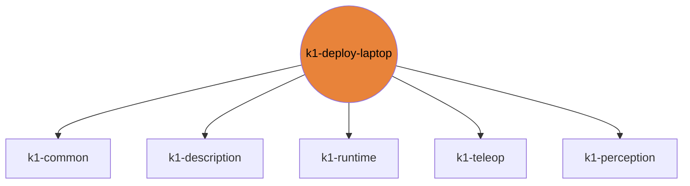

# k1-deploy-laptop

ROS 2 jazzy workspace, push-IK web/sim, pad sender, sim-to-sim.

| | |
|---|---|
| Layer | **L3**: Apps (processes you start) |
| May import | [k1-common](https://github.com/thdhyan/k1-common), [k1-description](https://github.com/thdhyan/k1-description), [k1-runtime](https://github.com/thdhyan/k1-runtime), [k1-teleop](https://github.com/thdhyan/k1-teleop), [k1-perception](https://github.com/thdhyan/k1-perception) |
| Files / LOC | 757 files · 6,909 lines (py, sh, cpp) |
| Part of | [k1-workspace](https://github.com/thdhyan/k1-workspace) (architecture and layering rules live there) |

## Where it sits



Used by: nothing (top layer).


## Install

```bash
uv add git+https://github.com/thdhyan/k1-deploy-laptop
# or, from a checkout
uv sync
```

## Usage

The laptop side: a ROS 2 Jazzy colcon workspace (`src/`), and the push-IK and pad tools (`deploy/`).

```bash
# ROS packages: k1_bringup, k1_control (needs the Booster SDK), k1_fleet_rviz, k1_locomotion, k1_sim_gazebo, k1_wbc
git submodule update --init sdk/booster_robotics_sdk    # Booster SDK, which k1_control's CMake expects here
source /opt/ros/jazzy/setup.bash && colcon build && source install/setup.bash
ros2 launch k1_fleet_rviz fleet_rviz.launch.py
```
| Tool (`deploy/`) | What |
|---|---|
| `pad_udp_send.py --host IP` | DS4 -> robot runner over UDP :9870 |
| `push_ik_web.py [--fake] [--send] --robots A B` | browser tool for the two-robot box push, http://127.0.0.1:8765 |
| `push_ik_sim.py` | CPU MuJoCo preview used by the web tool |
| `gamepad_sim.py` | MuJoCo sim-to-sim of the walk base (same `gamepad_core` as the robot) |

Robot IPs, safety and step-by-step runs: [docs/ROBOTS.md](https://github.com/thdhyan/k1-workspace/blob/main/docs/ROBOTS.md). The end-to-end test runs without hardware:
`pytest tests` (runs `tests/e2e_push_ik_web.py` and prints `WEB TEST OK`).

## Tests

From a k1-workspace checkout (see its README, "Run the tests"):
```bash
cd libs/k1-deploy-laptop && python -m pytest -q tests
```

## Robots and hosts

Robot IPs, SSH aliases, network, safety and how to control each robot: [docs/ROBOTS.md](https://github.com/thdhyan/k1-workspace/blob/main/docs/ROBOTS.md) in k1-workspace.

## Environment variables read

`K1_JOINTS`, `K1_LEG_JOINTS`, `K1_MODELS_DIR`

## Layout

```
MUJOCO_LOG.TXT
README.md
deploy/  (9 files)
  README.md
  gamepad_sim.py
  pad_udp_send.py
  push_ik_sim.py
  push_ik_web/  (3 files)
  push_ik_web.py
pyproject.toml
sdk/  (703 files)
  booster_robotics_sdk/  (703 files)
src/  (56 files)
  k1_bringup/  (10 files)
  k1_control/  (9 files)
  k1_fleet_rviz/  (8 files)
  k1_locomotion/  (8 files)
  k1_sim_gazebo/  (14 files)
  k1_wbc/  (7 files)
tests/  (3 files)
  e2e_push_ik_web.py
  test_push_ik_web.py
```

## Dependencies

- Declared sibling libraries: k1-common, k1-description, k1-runtime, k1-teleop, k1-perception (see `pyproject.toml`, `[tool.uv.sources]`).
- PyPI: evdev, imageio, mujoco, numpy, opencv-python, pytest, torch.
- Provided by the environment (ROS 2, Isaac, mjlab, robot SDK) or unresolved: `ament_index_python`, `geometry_msgs`, `launch`, `launch_ros`, `nav_msgs`, `push_ik_sim`, `rclpy`, `sensor_msgs`, `setuptools`, `std_msgs`, `tf2_msgs`.

## Hard-coded paths into other repos

These files still name paths that now live in another repo (hard-coded path strings, not imports). Pass them as arguments / config when you touch the file:

| File | Refers to | Owner |
|---|---|---|
| `deploy/gamepad_sim.py` | `mjlab_k1/` | k1-rl-mj |

## Old `booster_ws` layout still referenced

These files still name `booster_ws`, `isaac_tasks/` or `booster_train_ref` paths (container scripts not ported yet, or docstrings):

- `src/k1_bringup/setup.py`
- `src/k1_fleet_rviz/config/generate_rviz_config.py`
- `src/k1_fleet_rviz/launch/fleet_rviz.launch.py`
- `src/k1_locomotion/k1_locomotion/locomotion_node.py`

## Origin

Extracted from `booster_ws` (branch `dev/push-training-wip`, working tree of 2026-11-03) by
`tools/build_workspace.py` in k1-workspace. Old path to new path for every file: [`docs/migration_map.tsv`](https://github.com/thdhyan/k1-workspace/blob/main/docs/migration_map.tsv) (filter on `k1-deploy-laptop`).
History was not carried over: the working tree was copied as is, including previously untracked files.
